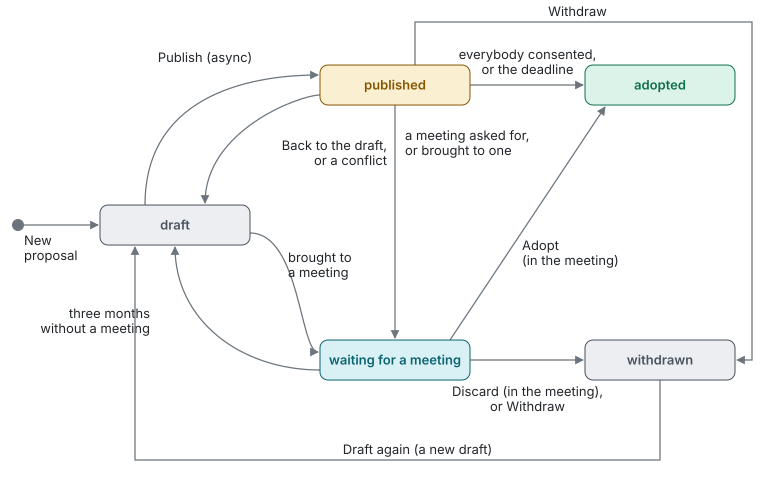

# Tensions and proposals

Governance only changes through proposals. A proposal is a **draft**,
**published** (async), **waiting for a meeting**, **adopted** or
**withdrawn**:

A tension turned into a proposal in a meeting starts out waiting.
Removed from a meeting's agenda, a proposal goes back to where it was,
except a published one the meeting processed already: that one becomes
a draft. Removing a circle or role withdraws its open proposals, drafts
too.

## Capturing a tension and drafting changes

"New proposal" on the circle's page. Choose the role the tension comes
from and describe it: what's missing, an example, how the proposal helps.
Without changes the draft stays a **tension** only you see (on your
page). You can work it out later or bring it to a meeting.

Under "Propose changes" you add, change or remove roles and policies,
move them into a sub-circle (also deeper down) or out of one into the
circle (the sub-circle's Secretary and Circle Leads get the mail about
it; policies regulating a domain stay with it), or turn a role into a
circle and back. The
draft shows everything as a comparison (in changed texts the removed
words in red, the added ones in green), together with what adopting it
would cause or why it can't be adopted like this. The changes are
grouped by role and policy: the pencil next to the name opens the role
or policy in the proposal with all its changes, the trash can discards
them all (after asking). In a role's form each new accountability and
domain has a field of its own, "Add another accountability" adds one;
"Remove" below an existing one removes it.

Adding roles inside a role makes it a circle; its Role Leads propose that
themselves. Policies come only after that: a role sets the policies for
its domains on its page. A circle without roles of its own turns back into a role when
the proposal is adopted, or, when the circle's own meeting removed its
last roles, when that meeting ends (after its closing round); its
policies are archived unless the same proposal moves them up (the draft
says so). A circle removed or turned back into a role takes its open
proposals with it (they're withdrawn), a removed circle's running
meeting ends; so does a removed role with the proposals for inside it.

The core roles (Circle Lead, Facilitator, Secretary, Circle Rep) stay as
the constitution defines them: proposals don't add accountabilities or
domains to them. A policy may transfer authority of the Circle Leads to
another role or process (e.g. how a role is assigned); the app doesn't
enforce such policies, the Circle Leads (or the Secretary) still record
the assignments.

Drafts are private until you publish them or bring them to a meeting.

## Publishing async

"Publish (async)" sends the proposal by mail to the circle's members (as
long as you still hold the role the tension comes from).
Until the deadline the circle sets (if a policy sets one), they respond:

- **no objection**, without a text (it's only counted)
- **question or comment**: you get a mail and answer it; your answer
  goes by mail to those who asked or commented.
- **discuss in a meeting**, if needed with the concern. The proposal then
  waits for the next governance meeting; you and the circle's Secretary
  get a mail.

When everybody else has no objection, the proposal is adopted right away,
otherwise within an hour after the deadline ("to be adopted on"); without
a deadline only when everybody consented. Somebody leaving the circle doesn't make it pass
earlier: it waits for the deadline.
Objections don't exist async, they're tested in the meeting: async is for
uncontroversial changes.

Consents and requests for a meeting are only counted ("3 of 7", of the
current members), questions and concerns show their author.

Published proposals can't be changed: "Back to the draft" (the circle
starts over afterwards) or "Withdraw". Both tell the circle's members by
mail. While its meeting runs, the secretary discards it there instead.

## Conflicts

When a proposal adopted meanwhile (async or in a meeting) changes what an
open proposal changes too, e.g. the same accountability, the open one
can't be adopted like this anymore. Lists and its page mark it as
**conflict**, its page says why. A published one goes back to your draft
right away, and the circle's members get a mail: open the role or policy
in the proposal, the form shows both versions to merge, and publish it
again (the circle starts over). One waiting for a meeting stays there,
the secretary merges it in the meeting. A role's own changes of the
policies for its domains are found the next night.

## Waiting for a meeting

A proposal waiting for a meeting (asked for, or left waiting by a meeting
with "Done") goes back to your draft after three months, counted from when
it started waiting or from the end of the last meeting it was on; you get
a mail. Not while a meeting has it on its agenda. Bring it to a meeting,
publish it again or delete it.

## Without a proposal

- **Policies of a domain**: whoever holds a role with a domain sets its
  policies on the role's page ("Policy" on the domain's line). The tool
  records the change as an adopted proposal and sends a mail. The policies
  move with the role; removing the domain, the role or its circle removes
  them too. Proposals of the circle don't change them, they may remove the
  domain.
- **Spelling** goes through governance: the secretary corrects it in a
  governance meeting.
